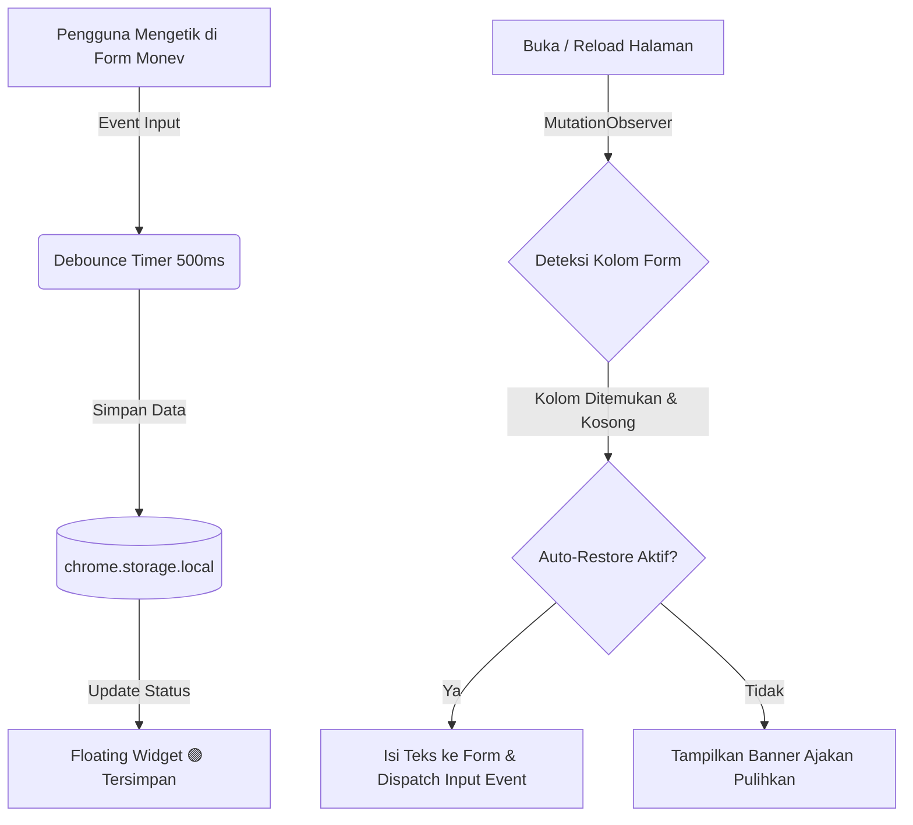

<p align="center">
  
</p>

<h1 align="center">MagangHub Auto-Draft Saver</h1>

<p align="center">
  <b>Ekstensi Browser (Manifest V3) untuk Menyimpan Sementara & Memulihkan Draft Laporan Harian di Portal Monev MagangHub Kemnaker.</b>
</p>

<p align="center">
  
  
  
</p>

---

## 📌 Latar Belakang Masalah

Saat mengisi riwayat aktivitas magang di portal **Monev MagangHub Kemnaker** (`https://monev.maganghub.kemnaker.go.id/dashboard/riwayat`), pengguna sering mengalami:
- Halaman tidak sengaja ter-reload (F5 atau gesture refresh).
- Sesi login habis atau koneksi terputus.
- Menutup tab browser secara tidak sengaja saat sedang mengetik laporan panjang.

Akibatnya, tulisan pada kolom **Uraian Aktivitas**, **Pemelajaran yang Diperoleh**, dan **Kendala yang Dialami** hilang total dan harus diketik ulang dari awal. Ekstensi ini dibuat untuk menyelesaikan masalah tersebut dengan menyimpan ketikan Anda secara otomatis dan aman di browser.

---

## ✨ Fitur Utama

- ⚡ **Penyimpanan Otomatis (Autosave Realtime):** Menyimpan setiap perubahan teks secara otomatis saat Anda mengetik dengan jeda *debounce* 500ms agar performa browser tetap ringan.
- 🔄 **Pemulihan Otomatis (Smart Auto-Restore):** Saat halaman dibuka kembali atau di-reload, draft yang tersimpan akan langsung otomatis mengisi kolom-kolom form.
- 🧩 **Dukungan Framework Modern (React / Vue / Inertia):** Menggunakan teknik *native value setter & event dispatching* sehingga state form internal di website Kemnaker tetap sinkron dan tidak hilang saat tombol kirim ditekan.
- 🎯 **Deteksi Kolom Cerdas:** Mengenali input melalui kombinasi label teks, placeholder, name, ID, dan struktur form:
  1. **Uraian Aktivitas**
  2. **Pemelajaran yang Diperoleh**
  3. **Kendala yang Dialami**
- 🟢 **Floating Widget di Pojok Halaman:** 
  - Indikator status penyimpanan (🟢 Tersimpan / 🟡 Sedang Menyimpan).
  - Tombol **✨ Pulihkan ke Form**.
  - Tombol **📋 Salin Semua** (backup cepat ke clipboard).
  - Tombol **💾 Simpan Manual**.
  - Tombol **🗑️ Hapus Draft** (setelah laporan resmi berhasil dikirim).
- 🗂️ **Extension Popup Menu:** Dapat diakses kapan saja melalui ikon toolbar browser untuk melihat isi draft, jumlah karakter, serta mengedit atau menyalin teks per kolom.

---

## ⚙️ Cara Kerja Ekstensi



1. **Injeksi Content Script:** Ekstensi mendeteksi URL `https://monev.maganghub.kemnaker.go.id/*`.
2. **Pengenalan Form:** Skrip mencari elemen `<textarea>` atau `<input>` yang berhubungan dengan kata kunci *uraian*, *pemelajaran/pembelajaran*, dan *kendala*.
3. **Penyimpanan Lokal:** Teks disimpan langsung ke dalam media penyimpanan internal browser (`chrome.storage.local`). Data Anda **100% aman dan privat di perangkat Anda**, tidak dikirim ke server pihak ketiga mana pun.
4. **Trigger Event Native:** Saat data dipulihkan, ekstensi mengeksekusi `prototype.value` setter dan menembakkan event `input` serta `change` agar library reactive (seperti Vue atau React yang dipakai di dashboard Kemnaker) mencatat nilainya secara sah.

---

## 📥 Panduan Instalasi (Langkah demi Langkah)

Ekstensi ini dapat dipasang pada semua browser berbasis Chromium seperti **Google Chrome**, **Microsoft Edge**, **Brave**, **Opera**, dll.

### 1. Download / Clone Repository
Pastikan folder proyek ini sudah ada di komputer Anda:
```bash
git clone https://github.com/devrnaldo/maganghub-draft-saver.git
```
*(Atau gunakan folder yang sudah Anda miliki di `C:\laragon\www\maganghub-draft-saver`)*.

### 2. Pasang di Browser
1. Buka browser favorit Anda (Google Chrome / Microsoft Edge / Brave).
2. Buka halaman pengaturan ekstensi:
   - **Google Chrome:** Buka URL `chrome://extensions`
   - **Microsoft Edge:** Buka URL `edge://extensions`
   - **Brave:** Buka URL `brave://extensions`
3. Aktifkan **Mode Pengembang / Developer Mode** (biasanya berupa saklar *toggle* di pojok kanan atas).
4. Klik tombol **Muat yang belum dibongkar** (*Load unpacked*).
5. Pilih folder:
   ```
   C:\laragon\www\maganghub-draft-saver
   ```
6. Ekstensi **MagangHub Auto-Draft Saver** berhasil dipasang dan akan muncul di daftar ekstensi!
7. *(Opsional)* Klik ikon pin 📌 di toolbar browser agar ikon MagangHub selalu terlihat.

---

## 🖥️ Cara Menggunakan

### 1. Penggunaan Sehari-hari di Portal Monev
1. Masuk ke akun Anda di [Monev MagangHub](https://monev.maganghub.kemnaker.go.id/dashboard/riwayat).
2. Buka form pengisian laporan harian/mingguan.
3. Di pojok kanan bawah layar, Anda akan melihat indikator kecil: **`[Logo] Draft Tersimpan`**.
4. Ketik laporan Anda seperti biasa:
   - Saat Anda mengetik, status akan berubah menjadi **`Menyimpan...`** (titik kuning berkedip).
   - Segera setelah Anda berhenti mengetik, status kembali menjadi **`Draft Tersimpan`** (titik hijau).
5. **Jika halaman ter-reload atau Anda keluar:**
   - Cukup buka kembali form tersebut.
   - Ekstensi akan secara otomatis mengisikan kembali teks yang sebelumnya sudah Anda ketik.

### 2. Menggunakan Fitur Widget & Popup
- **Ingin menyalin seluruh isi draft?** 
  Klik widget di pojok kanan bawah ➔ klik **📋 Salin Semua**. Seluruh teks (Uraian, Pemelajaran, Kendala) akan tersalin rapi ke clipboard.
- **Laporan sudah selesai dikirim?** 
  Klik widget ➔ klik **🗑️ Hapus Draft** agar form siap untuk pengisian hari berikutnya.
- **Melihat draft tanpa membuka form:** 
  Klik ikon ekstensi di toolbar browser (sebelah kolom URL) untuk melihat isi teks dan jumlah karakter secara langsung di popup.

---

## 🧪 Uji Coba Simulasi Lokal

Tersedia file simulasi lokal di folder proyek untuk menguji cara kerja ekstensi tanpa harus membuka portal Kemnaker:
1. Buka file berikut di browser Anda:
   ```
   file:///C:/laragon/www/maganghub-draft-saver/test/demo-riwayat.html
   ```
   *(Atau lewat Laragon: `http://localhost/maganghub-draft-saver/test/demo-riwayat.html`)*
2. Ketik sembarang teks di ketiga kolom yang tersedia.
3. Tekan tombol **Simulasi Reload Halaman (F5)**.
4. Perhatikan bahwa seluruh teks Anda kembali secara otomatis!

---

## 📁 Struktur Berkas

```
maganghub-draft-saver/
├── manifest.json            # Konfigurasi ekstensi Chrome Manifest V3
├── README.md                # Dokumentasi lengkap proyek
├── content/
│   ├── content.js           # Deteksi form, autosave, autorestore & floating widget
│   └── content.css          # Desain antarmuka floating badge & panel
├── popup/
│   ├── popup.html           # Tampilan antarmuka popup toolbar
│   ├── popup.css            # Styling modern antarmuka popup
│   └── popup.js             # Logika interaksi popup & manajemen storage
├── icons/
│   ├── icon.svg             # Logo resmi MagangHub (emblem simbol)
│   ├── icon-full.svg        # Logo resmi MagangHub lengkap dengan tipografi
│   ├── icon16.png           # Icon 16x16 untuk favicon / toolbar
│   ├── icon48.png           # Icon 48x48 untuk menu ekstensi
│   └── icon128.png          # Icon 128x128 untuk web store / install preview
└── test/
    └── demo-riwayat.html    # Halaman simulasi lokal pengujian
```

---

## 📄 Lisensi
Didistribusikan di bawah lisensi MIT. Silakan digunakan dan dikembangkan untuk membantu rekan-rekan magang lainnya!
